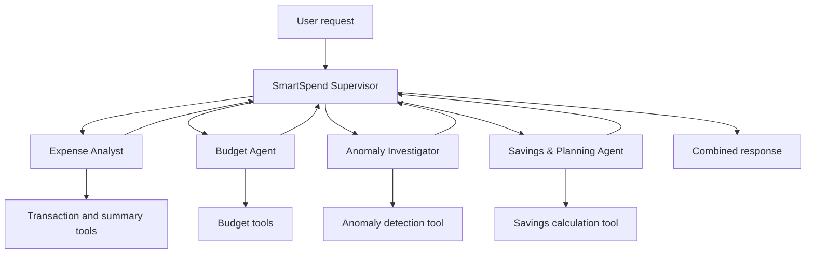

# SmartSpend Multi-Agent Architecture

## Overview

The Supervisor coordinates four focused specialist agents. Each specialist receives only
the existing deterministic finance tools relevant to its responsibility. Tool outputs
remain the source of truth for numeric results.



## Responsibilities

- **Expense Analyst:** ingestion, categorization and summaries.
- **Budget Agent:** budget management and status analysis.
- **Anomaly Investigator:** unusual/duplicate flags, with careful non-fraud wording.
- **Savings & Planning Agent:** calculations for savings-rate targets and reduction plans.
- **Supervisor:** task decomposition, specialist selection and synthesis.

## Notebook integration

Run the existing notebook through the cell that creates `smartspend_tools` and the LLM.
Then:

```python
from agents.multi_agent import build_multi_agent_system

system = build_multi_agent_system(llm, smartspend_tools)
supervisor = system["supervisor"]
supervisor_ctx = system["supervisor_context"]

result = await supervisor.run(
    "Analyze my spending, review budget risk, check anomalies and suggest a savings plan.",
    ctx=supervisor_ctx,
)
print(result)
```

This layer is deliberately additive: the deterministic finance functions are reused, not
rewritten. It requires the notebook's existing tool definitions and an available LLM.
